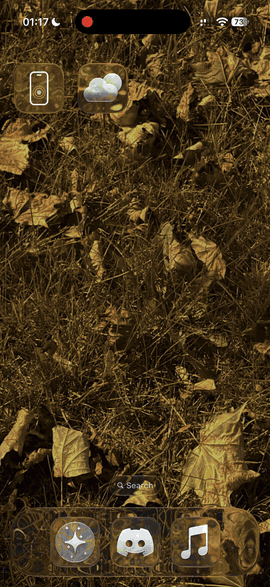

# iphone computer use

[english](README.md)

> [!WARNING]
> 需要在 iphone 上侧载，还需要一个 api key（anthropic、openai、gemini、openrouter 等都行）或者 claude 订阅。
>
> **用 claude 登录可能会让你的 claude 账号被限制或封号。** 它用 claude code 自己的 oauth client 登录，并告诉 api 自己是 claude code，因为只有这样订阅请求才能通过。anthropic [规定订阅账号只能登录它自家的应用](https://code.claude.com/docs/en/legal-and-compliance)，所以这样做是违反规定的。留着它是因为能用，不是因为允许这么做。如果你在乎自己的账号，就用 api key。
>
> 目前只在一台 iphone 上试过（16 pro，ios 27.0.1）。同一个 app 也能装到 ipad 上，但还没在 ipad 上跑过任务。

一个跑在 iphone 或 ipad 上的 agent，能操作设备上的任何 app。它会看屏幕、点击、打字和滑动。一次性配置好之后，按设计完全不需要电脑。

复刻自 [finn voorhees 的 demo](https://x.com/finnvoorhees/status/2108279639538012265)。

<p align="center"></p>

## 工作原理

- `App/` 是聊天 app。它把你的消息发给你选的模型（流式，因为没有 swift sdk，所以直接发原始 http），带四个工具：`phone_look`、`phone_act`、`phone_apps`、`current_time`。回复进行时，它会向 ios 申请一个 continued processing task（就是带停止按钮的“Replying”胶囊），这样别的 app 在前台时它也能继续干活。claude 走 anthropic 的 messages api，其他服务商都走 openai 风格的 chat completions api，由 `App/OpenAI.swift` 来回转换。
- `Runner/` 是一个永远不会结束的 ui 测试。它在 `127.0.0.1:8123` 上提供 http 服务：`/look`（截图 + 带点击位置的可读元素）、`/act`（tap、double_tap、long_press、swipe、type、key、home、open_app、open_url、wait）、`/apps`、`/known`、`/status`、`/stop`。每个请求都要带 `x-runner-token` header，post 请求必须是 json。在 ios 上，只有 xctest 能碰别的 app。
- `launcher/` 是基于 [idevice](https://github.com/jkcoxson/idevice) 的 rust 静态库。它直接在手机上启动这个 runner：先通过 vpn 建一条到手机自己的 `remotepairingd` 的 remote pairing 隧道（xcode 走 wifi 时用的就是它），需要的话挂载开发者磁盘镜像，然后通过 testmanagerd 启动 runner，全程都在这条隧道里。“Enter iPhone Passcode for XCTest”这个提示就是这么来的。iOS 27 的 lockdownd 会断掉从 vpn 进来的连接，所以以前走 lockdownd 的路子已经不通了（[原因](wiki/lessons/ios27-lockdownd-vpn.md)）。
- `Tunnel/` 是回环的 packet tunnel。发往 `10.7.0.1` 的包会把 src 和 dst 对调，再直接送回去，这样手机上的服务看到的就是一台从外面连进来的电脑。localdevvpn 和 stosvpn 用的也是这招，stikdebug 用的就是它们。用免费 apple 账号时，app 会改用 localdevvpn（见“安装”）。
- `setup/` 是一个小的 mac 工具，只跑一次。它在连到手机的 usb 隧道里生成 remote pairing 文件，用的是自己单独的身份，所以 app 的配对和 mac 的配对是分开的。第一次运行时，手机可能会问你要不要信任这台电脑。
- `control/` 是另一个独立的 mac 工具（`phone`），直接从这台机器通过 usb 操作手机，不需要手机上的 app，也不需要 vpn。截图、点击、滑动、打字、硬件按键都走 coredevice（xcode 的 device hub 用的就是它），所以锁屏时也能用。见 [control/README.md](control/README.md)。它也能操作 ipad；两台都在的话，用 `DEVICE=iphone` 或 `DEVICE=ipad` 指定是哪台。它是用来从 mac 操作和测试手机的；上面那个 app 才是跑在手机上的 agent。
- `plugin/` 把同一个 `phone` 工具做成 claude code 的 mcp 工具。claude 直接拿到截图，看着图点。用 `/plugin install phone --marketplace jxherc/phoness` 安装。它运行的是 `phone mcp`，所以要先构建 `control/`，再把 `phone` 放进 PATH，因为插件里不带二进制文件。

## 安装

你需要：

- xcode 27 和 xcodegen
- 通过 rustup 安装的 rust。`rust-toolchain.toml` 锁定了版本和 ios target，第一次构建时 rustup 会自动拉取
- 一个 apple 账号。免费的也行：免费 team 签不了内置的 vpn，所以 app 会改用 [LocalDevVPN](https://apps.apple.com/app/id6755608044)（免费，app store 上有）。付费开发者账号就能用 app 自带的
- 一台 ios 26 或更高版本的 iphone 或 ipad，打开开发者模式，信任这台 mac，并且打开 wifi（remotepairingd 需要）

[idevice](https://github.com/jkcoxson/idevice) 的源码直接放在 `launcher/idevice` 里：基于 commit 26a28f6，加了一个补丁（`XCUITestService::run_rsd`），这样 xctest 就能通过 remote pairing 隧道启动。

用你自己的 team 构建：改 `project.yml` 顶部的 `DEVELOPMENT_TEAM` 和 `AGENT_BUNDLE_ID`。tunnel、runner 和后台任务的 id 都是根据 `AGENT_BUNDLE_ID` 生成的。

然后插上 iphone 或 ipad 并解锁：

```bash
./scripts/setup.sh
```

用免费账号的话：

```bash
FREE_ACCOUNT=1 ./scripts/setup.sh
```

这样构建出来的版本不带 vpn entitlement。在点 iPhone Control（ipad 上是 iPad Control）> Turn On 之前，先装好 LocalDevVPN 并打开它。免费账号签名的 app 7 天后就打不开了，到时候再跑一遍脚本就行。

脚本会把 remote pairing 文件写到 `.pairing/<udid>.plist`（只有你能读），把 xcode 里的开发者磁盘镜像复制到 `App/Resources/Device/DDI/`，构建并安装 app 和 runner，最后把配对文件复制到手机上 app 自己的存储里。配对文件相当于这台手机的已配对主机凭证，所以它永远不会进 app bundle 或 git，app 也会把它排除在备份之外。旧版配置生成的配对文件（lockdown 那种）会被拒绝，并提示“run scripts/setup.sh again”。iphone 和 ipad 都在的话，脚本不会自己猜：用 `DEVICE=ipad ./scripts/setup.sh`（或者 `DEVICE=iphone`，或者 `UDID=<udid>`）。

在设备上：打开 Agent，点模型名，选一个服务商并添加它的 api key（或者用下面实验性的 claude 登录），然后点 iPhone Control（ipad 上是 iPad Control）> Turn On。允许添加 vpn，iOS 为“XCTest”要密码时输入你的密码。

## 服务商

点模型名，选服务商、模型，再填这个服务商的 api key。每个服务商的 key 单独存在钥匙串里，也会记住它上次用的模型。

- anthropic：claude，用 api key 或者下面的 claude 登录
- openai、google gemini、xai、openrouter、deepseek、mistral、groq、moonshot（kimi）：填这个服务商的 api key
- custom：任何兼容 openai 的服务器，你自己的也行。填 base url（比如 `https://example.com/v1`）、模型 id，需要的话再填 key

列表里只有能看图的模型，因为 agent 是看截图干活的。这些模型在 2026-10-26 对照 [models.dev](https://models.dev) 核对过。列表下面的模型 id 栏可以填这个服务商的任何其他 id。服务商和它们的 url 参照了 [pi](https://github.com/earendil-works/pi) 的列表。

## claude 登录

在设置里点 **sign in with claude**，在浏览器里完成登录，然后回到 app，粘贴完整的授权码（包括 `#` 后缀）或回调 URL。点 **finish sign-in**。app 会把 token 存在这台 iphone 的钥匙串里，并在过期前刷新。没完成的登录在关掉设置或重启 app 后依然有效，十分钟后过期。

登录状态下优先用 oauth。**sign out** 会删掉这个 app 保存的 token；它不会退出浏览器里的登录，也不会吊销其他会话。已有的 api key 会继续保存，退出登录后生效。oauth 请求被拒时，绝不会悄悄切换成付费 api。

这是一个实验性的兼容流程，用的是 claude 公开的 cli oauth client，不是注册过的第三方集成。订阅请求会先带上必需的客户端 system block，后面接原封不动的手机操作指令。API key 请求保留原来的 system prompt。[anthropic 只允许它自己的客户端使用订阅凭证](https://code.claude.com/docs/en/legal-and-compliance)，所以这种兼容方式以后可能会变。登录流程参照了[公开的 oauth 实现](https://github.com/ex-machina-co/opencode-anthropic-auth/blob/main/src/auth.ts)。

## 开发

- 先跑 `xcodegen generate`，改了 `project.yml` 之后要再跑一次。xcode 项目没有提交到仓库。
- 模拟器里 vpn、launcher 和后台任务都用不了。用 product > test（cmd+u）启动 runner，然后从模拟器主屏幕打开 Agent。scheme 里设了 `RUNNER_DEV=1`，所以这个 runner 会接受 app 默认用的固定 `dev` token。在模拟器里 app 进后台后只有 15 到 30 秒，之后就会被 ios 冻结，所以要在别的 app 里待更久的任务会卡住。更长的任务请用真机。
- app 会从环境变量里读 `ANTHROPIC_BASE_URL`，没保存 key 的时候还会读 `ANTHROPIC_API_KEY`。在 edit scheme > run > environment 里设置。`xcodegen generate` 会重置 scheme，想让它们一直生效的话，就写进 `project.yml` 的 run action 里。
- 如果 `xcode-select` 指向的是 command line tools，手动构建 rust 部分时需要 `DEVELOPER_DIR=/Applications/Xcode.app/Contents/Developer`。用 xcode 构建时已经设好了。
- `cargo run --release --example mac -- <phone ip> 49152 .pairing/<udid>.plist App/Resources/Device/DDI <app id>.runner.xctrunner`（在 `launcher/` 里运行）会在 mac 上对同一 wifi 下的手机跑完整的设备端启动流程。手机的 ip 和端口可以先用 `dns-sd -B _remotepairing._tcp`，再用 `dns-sd -L <name> _remotepairing._tcp` 查到。
- `setup/target/release/phonelog <udid> "lockdownd|remotepairingd|Agent["` 会实时输出过滤后的手机 syslog。app 会把 `launcher.log` 写在它的配对文件旁边。
- `./scripts/test-auth.sh` 会用模拟的响应检查 oauth 协议和 token 生命周期，不会用到你的钥匙串或真实账号。
- `./scripts/test-api.sh` 用预设的响应检查兼容 openai 的客户端：历史记录的双向转换、流式输出、各服务商的特殊要求和报错。

## 限制

- 设备端启动（vpn、remote pairing 隧道、磁盘镜像检查、runner 启动）在 2026-10-20 于一台 ios 27.0.1 的 iphone 16 pro 上跑过。那台手机上的磁盘镜像本来就已经挂载了，所以挂载这一步本身还没在手机上跑过。2026-10-21 在同一台手机上完整跑通了一次（就是上面的 demo）：它切到天气 app，在“Replying”任务下继续在后台工作，然后给出了回答。其他手机和 ios 版本都没测过。
- iphone 和 ipad 用的是同一个 app。2026-10-26 在 ipad 模拟器（11 寸，ios 27.0）上检查了竖屏、横屏和小窗口下的聊天界面，也在这三种情况下检查了 runner 的截图和点击，包括 app 开在不贴角的窗口里的情况。真机 ipad pro（ios 27.0.1）上已经装好，但还没打开 iPad Control，也没跑过任务。
- 每次启动 runner 都要输密码。app 的 testmanagerd 连接一断（比如 app 被杀掉），ios 就会丢掉 runner。下一条消息会重新启动它。
- runner 用了私有 api。它像 webdriveragent 那样跳过 xctest 的 wait-for-idle，通过 xctest 的 accessibility client 查前台是哪个 app，app 列表则回退用 `LSApplicationWorkspace` 获取（在手机上列表来自 installation_proxy）。新版 xcode 可能会让其中任何一项失效，代码会逐步检查并回退。
- 不管从 app 还是从 `examples/mac.rs` 启动，runner 每次的 token 都是新的。从 xcode 启动的 runner 用固定的 `dev` token，所以它运行期间，手机上任何 app 都能操作它。这只用于开发。runner 只监听 127.0.0.1，并拒绝其他主机名，所以网页没法通过 dns rebinding 访问它。
- agent 会读其他 app 的屏幕。prompt 里告诉它屏幕上的文字只是内容，绝不是指令，但专门写来引导它的网页或消息还是可能会尝试。代码里没有任何地方会在它点击、打字或打开链接前问你，所以要盯着它在做什么。
- 本地的 app 可以占满 runner 的 16 个连接槽，在它释放之前 agent 都连不上。它没法借此读取或操作任何东西。
- vpn 打开时，手机上任何 app 都能连到 `10.7.0.1` 上的 remotepairingd。握手之后想做任何事都需要配对文件。app 会随 iPhone Control 一起关掉 vpn。
- remotepairingd 似乎需要打开 wifi。stikdebug 对同一条路径也是这么说的。没在蜂窝网络下试过。
- 横屏还没测过。
- 其他服务商：2026-10-26 兼容 openai 的那条路跑通了一次真实的工具循环，带截图，通过本机的代理连到 gemini 3.8 flash 和 claude sonnet 4.6，一次在 mac 的测试 harness 里，一次在模拟器的 app 里（它打开了设置，看了屏幕，答对了）。列表里每个服务商的接口都对一个编出来的 key 返回了清楚的报错，所以 url 是对的。openai、gemini、xai、openrouter、deepseek、mistral、groq、moonshot 都没用真实 key 试过，所以它们的回复还没测。xai 把它的 chat completions api 标成了已弃用，没给停用日期。
- 2026-10-20 测试通过了真实的 claude oauth 登录、token 刷新和直接用 Opus 5.5 回复。缺少开头的客户端 system block 时，即使订阅还有可用额度，也会返回一个笼统的 HTTP 429；加上之后，刷新前后都返回 HTTP 200。响应确认了订阅内含的用量可以用，付费超额用量是关闭的。没改过的 Swift 客户端也在一个临时的 macOS 测试 harness 里流式输出了回复，并带着全部四个工具定义完成了一次 `current_time` 工具调用往返。模拟器和真机构建都通过了；最近一次模拟器屏幕检查卡在了 Xcode device viewer 的启动上。真机上的实际表现仍未验证。一个[吻合的复现](https://github.com/anthropics/claude-code/issues/87420)记录了同样的请求要求。

## 许可证

mit，见 [LICENSE](LICENSE)。`launcher/idevice/` 是 jackson coxson 写的 [idevice](https://github.com/jkcoxson/idevice)，同样是 mit（[它的许可证](launcher/idevice/LICENSE.txt)），加了一个小补丁。
